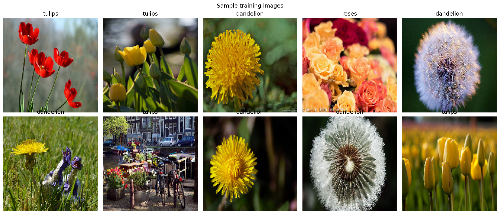
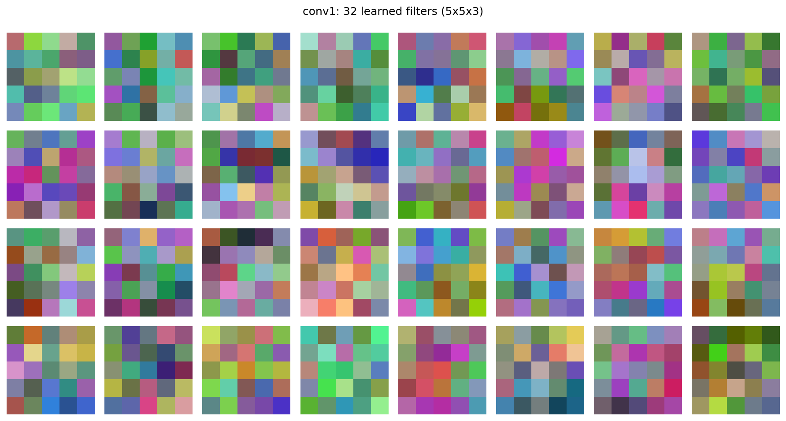
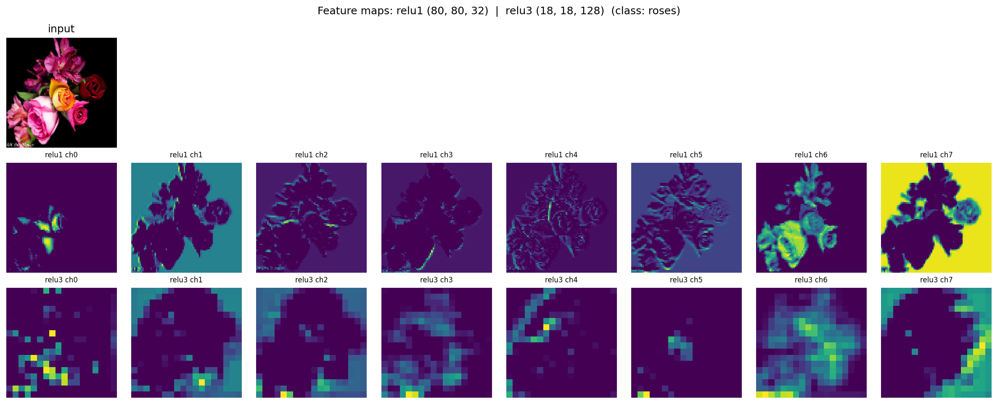
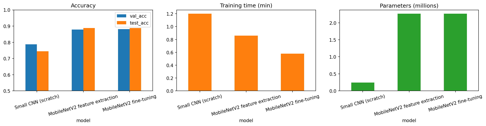
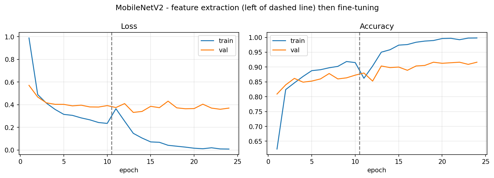
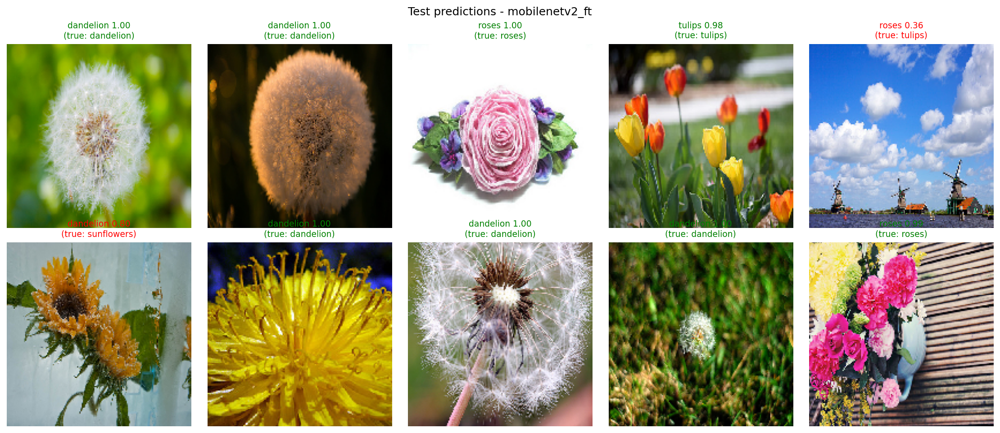

<div align="center">

# 🌸 Flower CNN, Transfer Learning & Object Detection

**A small CNN built from scratch vs. MobileNetV2 transfer learning on 5 flower classes, plus a speed-and-size comparison of three COCO object detectors.**

[](https://www.python.org/)
[](https://www.tensorflow.org/)
[](https://keras.io/)
[](https://pytorch.org/)
[](https://pytorch.org/vision/)
[](https://scikit-learn.org/)
[](https://colab.research.google.com/)
[](https://colab.research.google.com/github/furqanzubair209-cell/flower-cnn-transfer-learning-detection/blob/main/Assignment3_CNN_TransferLearning_Detection.ipynb)

[](#-results-at-a-glance)
[-blueviolet)](#-dataset--validation-protocol)
[](#-object-detection)
[](Assignment3_CNN_TransferLearning_Detection.ipynb)
[](LICENSE)
[](#-author)

[](https://github.com/furqanzubair209-cell/flower-cnn-transfer-learning-detection/stargazers)
[](https://github.com/furqanzubair209-cell/flower-cnn-transfer-learning-detection/network/members)

[Overview](#-overview) • [Results](#-results-at-a-glance) • [Pipeline](#-pipeline) • [Detection](#-object-detection) • [Run it](#-how-to-run) • [Structure](#-repository-structure) • [Author](#-author)

</div>

---

## 📌 Overview

This project answers one practical question: **how much does a pre-trained network help compared with training a CNN from scratch, and what does it cost to run different object detectors?**

It has two parts, both in a single Google Colab notebook:

1. **Image classification (TensorFlow / Keras)** on the 5-class `flower_photos` dataset. Three models are trained and judged under *one identical protocol*:
   - a **small 4-block CNN built from scratch**,
   - **MobileNetV2 feature extraction** (frozen ImageNet backbone, new head),
   - **MobileNetV2 fine-tuning** (top 30 layers unfrozen, small learning rate).
2. **Object detection (PyTorch / torchvision)**: three COCO-pre-trained detectors are run on six images, producing bounding boxes with class labels and confidence scores. Speed, parameters and GPU memory are measured.

The notebook also explains the core CNN ideas (convolution, filters, stride, padding, activation, pooling) and ties each one to a layer of the model, with learned filters and feature maps visualised.

## 🏆 Results at a glance

### Classification (test set, 551 images)

| Model | Val acc | **Test acc** | Trainable params | Total params | Model file | Latency (ms/img) |
|---|:---:|:---:|---:|---:|---:|:---:|
| Small CNN (from scratch) | 0.787 | **0.744** | 243,365 | 244,069 | 3.02 MB | 2.55 |
| MobileNetV2 feature extraction | 0.878 | **0.887** | 6,405 | 2,264,389 | 9.71 MB | 3.76 |
| MobileNetV2 fine-tuning | 0.905 | **0.907** | 1,517,125 | 2,264,389 | 21.80 MB | 3.53 |

- **+14.3 points** test accuracy from transfer learning (feature extraction) over the scratch CNN, training only **6,405** parameters.
- **+2.0 points** more from fine-tuning (+2.73 on validation). This gain is small: on 550 validation images, one percentage point is only about 5–6 images, so it should be read with care.
- All three models trained in roughly **one minute** each on a Tesla T4.
- Latency includes Keras `predict` overhead (32-image batch, averaged over 10 runs).

### Object detection (6 COCO val images, score ≥ 0.5, Tesla T4)

| Detector | Params | ms / image | FPS | Peak GPU mem | Detections | Mean confidence |
|---|---:|---:|---:|---:|---:|:---:|
| Faster R-CNN ResNet50-FPN | 41.76 M | 145.7 | 6.9 | 586 MB | 58 | 0.832 |
| Faster R-CNN MobileNetV3-FPN | 19.39 M | 39.5 | 25.3 | 308 MB | 44 | 0.826 |
| SSDlite320 MobileNetV3 | 3.44 M | 33.3 | 30.0 | 52 MB | 16 | 0.798 |

ResNet50-FPN is the most thorough but is about **4.4× slower**, **12× larger** and uses about **11× more GPU memory** than SSDlite, which suits edge devices but finds fewer objects.

## 🔬 Pipeline

```
flower_photos (3,670 imgs, 5 classes)
        │
        ▼
 Stratified 70/15/15 split (seed 42) ──► saved to split.json, reused by every model
        │
        ▼
 160×160 uint8 tf.data pipeline  +  augmentation (flip, rotation ±0.08, zoom 10%)
        │
        ├──► Small CNN (scratch) ─────────────┐
        ├──► MobileNetV2 feature extraction ──┼──► same optimiser, callbacks, metrics
        └──► MobileNetV2 fine-tuning ─────────┘
                                              │
                                              ▼
                         comparison table, charts, confusion matrices

 6 COCO images ──► 3 pre-trained detectors ──► boxes + labels + scores ──► speed / size comparison
```

### The small CNN

Four blocks of `Conv → BatchNorm → ReLU → MaxPool`, then global average pooling, dropout (0.4) and a 5-way softmax.

| Layer | Config | Output |
|---|---|---|
| conv1 | 32 filters, 5×5, stride 2, same | 80×80×32 |
| conv2 | 64 filters, 3×3, same | 40×40×64 |
| conv3 | 128 filters, 3×3, **valid** | 18×18×128 |
| conv4 | 128 filters, 3×3, same | 9×9×128 |
| gap → dropout → classifier | GlobalAvgPool, Dropout 0.4, Dense 5 | 5 |

Each block ends with 2×2 max pooling (80→40, 40→20, 18→9, 9→4). Using global average pooling instead of a large flatten + dense layer keeps the whole model at **244,069 parameters**.

### Transfer learning

| Stage | What is trained | Learning rate |
|---|---|---|
| Feature extraction | New head only (GAP → Dropout 0.2 → Dense 5), backbone frozen | 1e-3 |
| Fine-tuning | Top 30 backbone layers + head; **BatchNorm layers stay frozen** | 3e-5 |

The backbone is selected **by name**, and an `assert` checks that the backbone is really unfrozen before fine-tuning starts. This avoids the common bug of unfreezing the wrong block.

## 🧪 Dataset & validation protocol

- **Dataset:** TensorFlow `flower_photos`, 3,670 JPEGs, 5 classes: daisy, dandelion, roses, sunflowers, tulips.
- **Split:** one stratified **70 / 15 / 15** split (seed 42): **2,569** train, **550** validation, **551** test. It is created once, saved to `results/split.json` and reused by all models.
- **Same recipe for all models:** identical augmentation, Adam optimiser, batch size 32, sparse categorical cross-entropy, and the same callbacks (best-val-accuracy checkpoint, early stopping with weight restore, `ReduceLROnPlateau`).
- **Selection on validation only.** The "best model" is chosen by validation accuracy; the test set is used for the final report.

## 🎯 Object detection

Three torchvision detectors pre-trained on COCO are run in inference mode on six COCO validation images:

| Model | Idea |
|---|---|
| `fasterrcnn_resnet50_fpn` | Large, most thorough |
| `fasterrcnn_mobilenet_v3_large_fpn` | Lighter middle option |
| `ssdlite320_mobilenet_v3_large` | Smallest and fastest |

Boxes with confidence ≥ 0.5 are kept. After one untimed warm-up run, each image is timed with `torch.cuda.synchronize()` before and after the forward pass. Every detection is saved to `results/detections.csv` and the timing to `results/detection_timing.csv`.

## 🖼️ Figures

> The notebook saves all figures to a `figures/` folder. Copy them into this repository's `figures/` folder so the images below show up.

| | |
|---|---|
|  |  |
| *Random training images* | *32 learned 5×5 filters of `conv1`* |
|  |  |
| *Feature maps at `relu1` and `relu3`* | *Accuracy, training time, parameters* |
|  |  |
| *Feature extraction then fine-tuning* | *Test predictions of the best model* |

Confusion matrices: `figures/cm_small_cnn.png`, `figures/cm_mobilenetv2_fe.png`, `figures/cm_mobilenetv2_ft.png`.
Detection comparisons (three models side by side per image): `figures/det_01_….png` to `figures/det_06_….png`.

## 🚀 How to run

### Google Colab (recommended)

1. Click the **Open in Colab** badge at the top.
2. Set the runtime to **GPU** (*Runtime → Change runtime type → T4 GPU*).
3. Run all cells. The first cell mounts Google Drive and creates a `CV_Assignment3/` project folder where models, histories, figures and results are stored.

Notes:
- Saved models on Drive are **reused** on later runs. Set `FORCE_RETRAIN = True` in the first cell to train everything again.
- The dataset is downloaded automatically and cached on Drive.
- The COCO images are downloaded from `images.cocodataset.org`.

### Requirements

```text
tensorflow>=2.16
torch
torchvision
scikit-learn
pandas
numpy
matplotlib
pillow
requests
```

The notebook was run with TensorFlow 2.21 and PyTorch 2.11 on a Tesla T4. To run locally you need to replace the Google Drive mount with a local folder path (the `PROJECT` variable in the first cell) and remove the `google.colab` imports.

## 📁 Repository structure

```
.
├── Assignment3_CNN_TransferLearning_Detection.ipynb   # full notebook (code + outputs)
├── Assignment3_Report.pdf                             # written report
├── summary.txt                                        # one-page results summary
├── results/
│   ├── results.json                                   # all metrics
│   ├── classification_comparison.csv                  # classifier comparison table
│   ├── detection_timing.csv                           # detector speed / size
│   ├── detections.csv                                 # every box, label and score
│   └── split.json                                     # the fixed train/val/test split
└── figures/                                           # plots saved by the notebook
```

## 💡 Key takeaways

- **Pre-trained features beat training from scratch** on a small dataset (about 2.5k training images): 88.7% vs. 74.4% test accuracy, while training 40× fewer parameters.
- **Fine-tuning helps a little**, at the cost of 1.5 M trainable parameters and a bigger model file, and with a higher over-fitting risk. The gain is only a few images.
- **Bigger detectors find more objects but cost much more** time and memory. The right choice depends on the hardware.

## ⚠️ Limitations

- Results come from **one split and one seed**; no repeated runs or confidence intervals.
- Detection is compared on **six images only** and reports speed and detection counts, not mAP, so it shows trade-offs and is not an accuracy benchmark.
- Timings come from a single T4 GPU and include Keras `predict` overhead for the classifiers, so they are indicative, not a strict benchmark.

## 🛠️ Tech stack

`Python` · `TensorFlow / Keras` · `PyTorch / torchvision` · `scikit-learn` · `pandas` · `NumPy` · `Matplotlib` · `Google Colab (Tesla T4)`

## 👤 Author

**Muhammad Furqan**: BS Computer Science, The Superior University Lahore (Computer Vision course project)

[](https://github.com/furqanzubair209-cell)
[](https://www.linkedin.com/in/muhammad-furqan-228807304)
[](https://furqannewportfolio.netlify.app)

## 📄 License

Released under the [MIT License](LICENSE). Add a `LICENSE` file to the repository (GitHub can create one for you when you add the file).

---

<div align="center">

If this project helped you, consider giving it a ⭐

</div>
